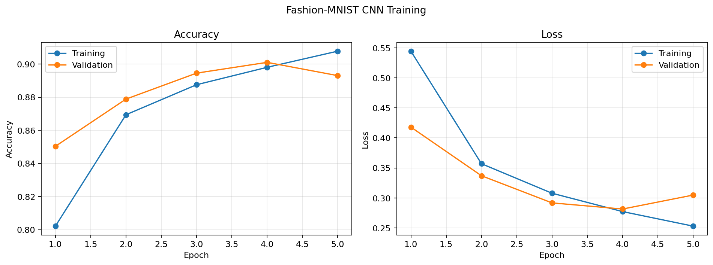
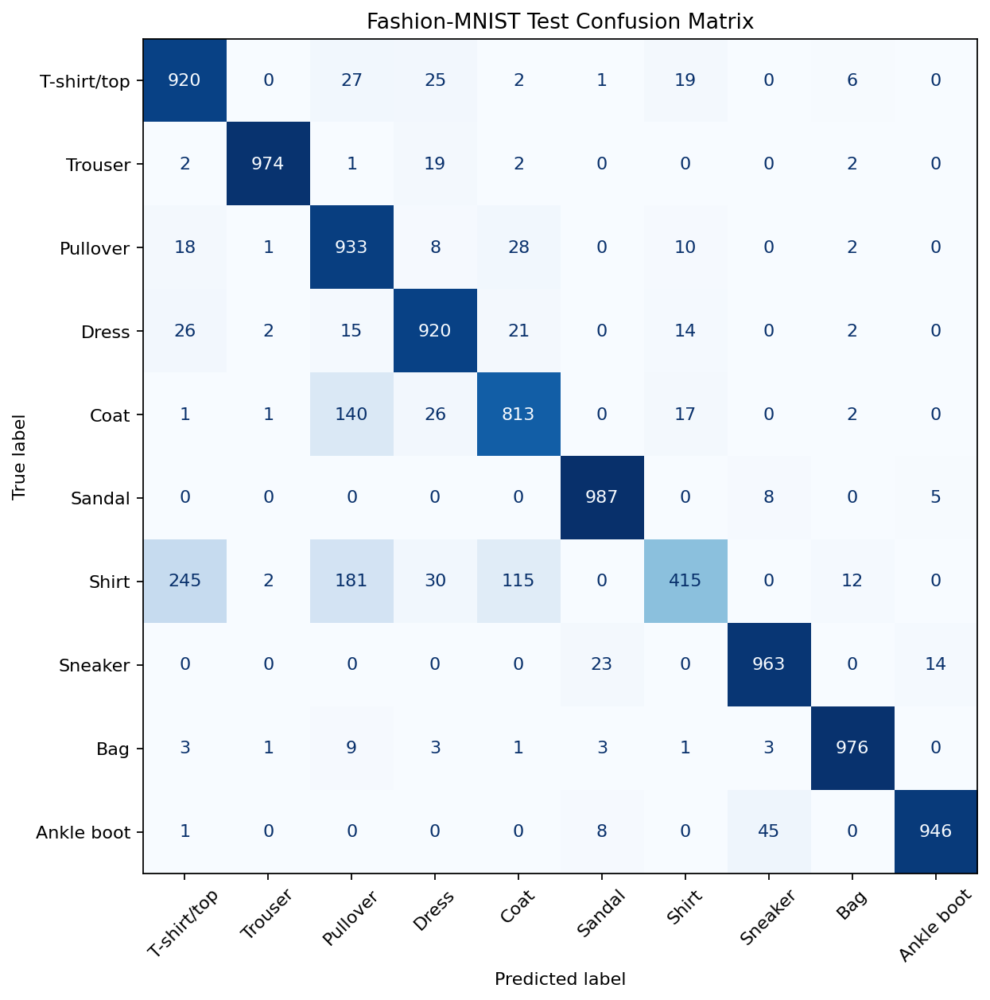
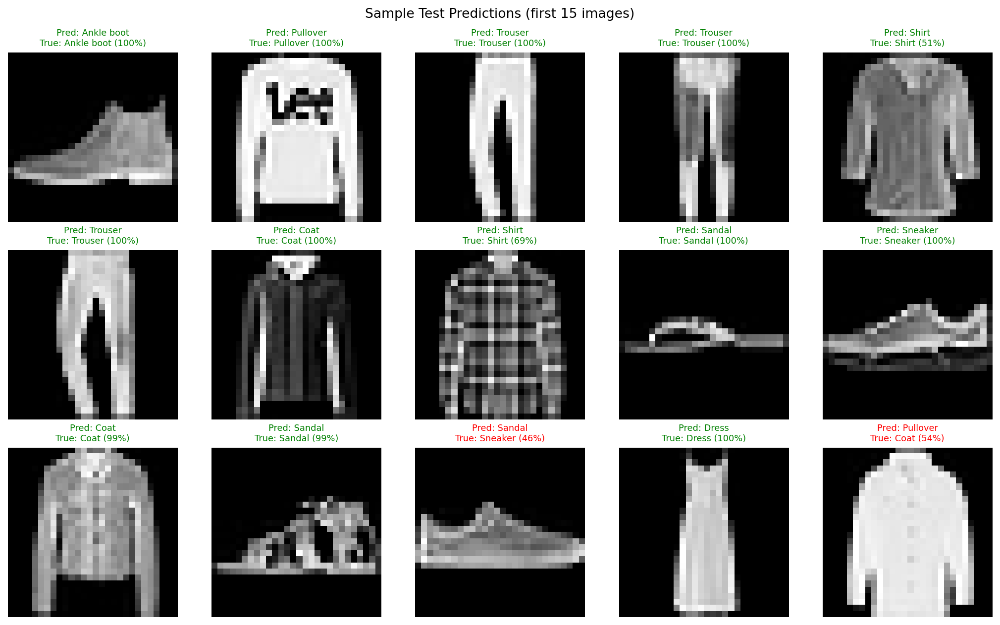

# Day 17: Fashion-MNIST CNN Classifier

A small, reproducible image-classification project built with TensorFlow/Keras.
The training script downloads Fashion-MNIST when needed, trains a convolutional
neural network, evaluates it against the full training and test sets, and saves
the model and visual results in `outputs/`.

## Run the project

From this folder, install the dependencies and train the model:

```bash
python -m pip install -r requirements.txt
python fashion_mnist_project.py
```

The default run trains for five epochs with batches of 64. You can adjust these
settings or choose another output folder:

```bash
python fashion_mnist_project.py --epochs 8 --batch-size 64
python fashion_mnist_project.py --output-dir outputs
```

The script uses the 60,000 training images for fitting (with 10% held out for
validation) and evaluates the trained model on all 60,000 training images and
the 10,000 official test images. A fixed random seed makes runs more
reproducible, although exact results can vary across TensorFlow versions and
hardware.

## Why a CNN instead of a fully connected ANN?

An ANN that starts with dense layers must flatten each image into 784 unrelated
pixel values. This discards the two-dimensional arrangement and uses many
parameters to learn local visual patterns. A convolutional neural network
(CNN) keeps the image grid intact, reuses the same filters across positions,
and learns local patterns such as edges and clothing details. This spatial
structure and weight sharing make CNNs a natural, more parameter-efficient
choice for image data.

## Convolution and pooling

- **Convolution** slides learned filters over the image to detect local
  patterns. Stacking convolution layers lets later layers combine simpler
  patterns into more useful visual features.
- **Max pooling** downsamples feature maps by keeping the strongest activation
  in each small window. This reduces the spatial computation and makes the
  representation less sensitive to small shifts.

## Model architecture

Input images are grayscale `28 x 28` pixels. Pixel values are scaled from
`0..255` to `0..1`, and a channel dimension is added for the convolution
layers. The model is:

1. `Conv2D(32, 3 x 3, ReLU)` → `MaxPooling2D(2 x 2)`
2. `Conv2D(64, 3 x 3, ReLU)` → `MaxPooling2D(2 x 2)`
3. `Flatten` → `Dense(128, ReLU)` → `Dropout(0.3)`
4. `Dense(10, softmax)` for the ten clothing categories

The model uses Adam and sparse categorical cross-entropy, so integer class
labels can be used directly without one-hot encoding.

## Results

Results below are from the run recorded in `outputs/metrics.json`.
Training accuracy and loss are evaluated on the **complete 60,000-image
training set** after fitting; test accuracy and loss are evaluated on all
10,000 official test images.

| Evaluation set | Images | Accuracy | Loss |
| --- | ---: | ---: | ---: |
| Training | 60,000 | **90.17%** | **0.2655** |
| Test | 10,000 | **88.47%** | **0.3351** |

### Training accuracy and loss



### Test confusion matrix



Rows in the confusion matrix are the true classes and columns are the predicted
classes. The diagonal contains correct predictions; off-diagonal cells show
which classes the model confuses. In this run, `Shirt` is the most commonly
confused class: 245 shirts were predicted as `T-shirt/top`, 181 as `Pullover`,
and 115 as `Coat`. The short training run achieves 88.47% test accuracy.

### Sample predictions

Green titles indicate a correct prediction and red titles indicate an error.
The displayed percentage is the model's confidence in its predicted class.



## Challenges and solutions

- **CNN input shape:** the source images have shape `(28, 28)`, while
  `Conv2D` expects a channel axis. The script normalizes the pixels and adds
  that axis to produce `(28, 28, 1)` images.
- **Interpreting training scores:** the final `fit` training metric covers only
  the 90% fitting split because 10% is reserved for validation. To report an
  unambiguous full-training score, the script separately evaluates the model
  on all 60,000 training images after fitting.
- **Visually similar categories:** related garments can be difficult to tell
  apart from small grayscale images. The saved confusion matrix and labeled
  predictions make these errors visible for inspection.

## Short video walkthrough

[`fashion_mnist_demo.mp4`](outputs/fashion_mnist_demo.mp4) is a short,
captioned visual walkthrough of the model, training results, and test
predictions. It is generated from the project output figures and is intended
as a concise presentation of the training and testing run.

## Output files

- `outputs/fashion_mnist_cnn.keras` — trained model
- `outputs/metrics.json` — measured training/test metrics, class labels, and
  per-epoch history
- `outputs/training_curves.png` — training and validation accuracy/loss
- `outputs/confusion_matrix.png` — test-set confusion matrix
- `outputs/sample_predictions.png` — labeled test-image predictions
- `outputs/fashion_mnist_demo.mp4` — short visual walkthrough
