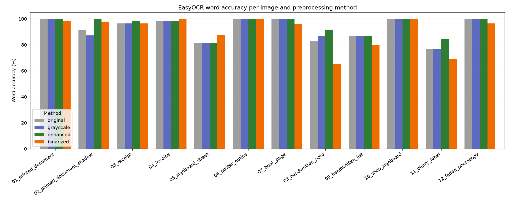

# Task 1 – Text Extraction with EasyOCR

Read text from 12 different images with EasyOCR, compare the results, and test
whether grayscale conversion and image enhancement improve the output.

## Setup

This project requires Python 3.11.x. EasyOCR dependencies may try to compile from source with other Python versions, causing Microsoft C++ Build Tools errors. Use the Python launcher commands below rather than bare `pip` or `python`.

```bash
py -3.11 -m pip install -r requirements.txt
```

The first run downloads the EasyOCR English models (about 100 MB), so you need
internet once. The script uses a GPU automatically if PyTorch can find one;
otherwise it runs on the CPU (around 4–5 seconds per image).

## How to run

```bash
py -3.11 make_test_images.py   # only needed if the images/ folder is empty
py -3.11 easyocr_task.py       # runs OCR and writes everything to outputs/
```

To test your own photos, drop them into `images/`. A ground-truth text file
(`images/ground_truth/<same name>.txt`) is optional. Without one, the script
still prints the text, confidence and word count, but no accuracy.

## Folder structure

```
Task1_EasyOCR/
├── easyocr_task.py        main script: OCR + preprocessing + comparison
├── make_test_images.py    creates the test images and their correct text
├── requirements.txt
├── fonts/                 free fonts used by make_test_images.py
├── images/                12 test images
│   └── ground_truth/      correct text for each image (used for accuracy)
└── outputs/
    ├── ocr_results.csv    one row per image per method
    ├── report.md          comparison tables
    ├── comparison_chart.png
    ├── text/              extracted text for every image, all 4 methods side by side
    ├── annotated/         boxes + detected text drawn on the image (original vs enhanced)
    └── preprocessed/      what the image looked like after grayscale / enhanced / binarized
```

## Test images

| # | Image | Category | Source | What makes it hard |
|---|---|---|---|---|
| 01 | printed_document | Printed document | generated | Clean scan, the easy baseline |
| 02 | printed_document_shadow | Printed document | generated | Phone photo: heavy shadow, angle, low contrast |
| 03 | receipt | Receipt | generated | Faded thermal print, small font, tilted, on a dark table |
| 04 | invoice | Invoice | generated | Table layout with lines |
| 05 | signboard_street | Signboard | **real photo** (EasyOCR repo) | White text on dark signs, French words, busy background |
| 06 | poster_notice | Poster / notice | **real image** (EasyOCR repo) | White text on blue, icons mixed with the text |
| 07 | book_page | Book page | generated | Old yellow paper, dark near the spine |
| 08 | handwritten_note | Handwritten | generated | Handwriting-style font, blue ink on ruled paper |
| 09 | handwritten_list | Handwritten | generated | Light pencil, low contrast, shadow |
| 10 | shop_signboard | Signboard | generated | Evening light (very dark), blur, perspective |
| 11 | blurry_label | Product label | generated | Tiny (230 px wide) and out of focus |
| 12 | faded_photocopy | Printed document | generated | Faded photocopy with speckle noise |

"Generated" images are made by `make_test_images.py` and deliberately damaged
(shadow, blur, noise, tilt, JPEG compression) to copy real phone photos.
Because we generate them, we know their exact text, so accuracy can be measured
instead of judged by eye. The handwritten samples use handwriting fonts. They
are a stand-in, not real handwriting, so real handwritten photos should score lower.

## Preprocessing methods compared

1. **original**: the image as it is.
2. **grayscale**: colour removed only.
3. **enhanced**: grayscale → upscale small images → turn light-on-dark text into
   dark-on-light → shadow removal (background division) → denoise → CLAHE contrast.
4. **binarized**: the enhanced image turned into pure black and white
   (adaptive threshold).

## Results

| Method | Avg word accuracy | Avg char accuracy | Avg confidence | Avg time (CPU) |
|---|---|---|---|---|
| original | 92.8% | 96.5% | 86.2% | 4.5 s |
| grayscale | 93.0% | 97.0% | 85.6% | 4.5 s |
| **enhanced** | **95.0%** | **97.1%** | **87.0%** | 4.8 s |
| binarized | 90.6% | 95.7% | 83.9% | 4.5 s |

Word accuracy per image (full tables in `outputs/report.md`):

| Image | original | grayscale | enhanced | binarized |
|---|---|---|---|---|
| 01 printed_document | 100 | 100 | 100 | 98.4 |
| 02 printed_document_shadow | 91.5 | 89.4 | **100** | 97.9 |
| 03 receipt | 96.5 | 96.5 | **98.2** | 96.5 |
| 04 invoice | 98.0 | 98.0 | 98.0 | **100** |
| 05 signboard_street | 81.2 | 81.2 | 81.2 | **87.5** |
| 06 poster_notice | 100 | 100 | 100 | 100 |
| 07 book_page | 100 | 100 | 100 | 95.8 |
| 08 handwritten_note | 82.6 | 87.0 | **91.3** | 65.2 |
| 09 handwritten_list | 86.7 | 86.7 | 86.7 | 80.0 |
| 10 shop_signboard | 100 | 100 | 100 | 100 |
| 11 blurry_label | 76.9 | 76.9 | **84.6** | 69.2 |
| 12 faded_photocopy | 100 | 100 | 100 | 96.4 |



## Observations

**Comparing image types**
- **Printed text is the easy case.** Clean documents, the book page, the poster
  and the faded photocopy all reached 100% even without preprocessing.
  EasyOCR's detector (CRAFT) and recognizer handle printed fonts very well.
- **Signboards are mixed.** The synthetic shop sign was read perfectly even when
  very dark. The real Paris street sign was the hardest printed image (81%):
  the small superscript in "Ier" came out as "r|", "PALAIS-ROYAL" became
  "PALA/S-Royalt", and stray "[" characters appeared from the walking-man icons.
- **Receipts** were read almost completely (96–98% of words). The real problem is
  layout: item names and prices come back as separate boxes, and on a tilted
  receipt they don't line up neatly. That's why character accuracy is lower
  there (73–79%). The words are right; the line order isn't.
- **Handwriting is the weakest category.** Typical mistakes on the note:
  "Tuesday" → "Tuesdav", "USB" → "UCB", a stray "j" after "key", and spaces lost
  ("11 am" → "11am"). The pencil list was actually read correctly; it only lost
  points on spacing ("1 kg" → "1kg"). Word accuracy counts that as a miss, while
  character accuracy (98.8%) shows how small the error is.
- **Low resolution hurts a lot.** The 230-pixel label lost words until it was upscaled.

**Effect of preprocessing**
- **Grayscale alone changes almost nothing** (92.8% → 93.0%). That's expected:
  EasyOCR converts every image to grayscale internally before recognition, so
  doing it ourselves mostly just saves memory.
- **Enhancement gave the best average** (95.0%) and never made any image worse
  than the original. It mattered most where the problem matched the fix:
  - shadowed document: 91.5% → **100%** (shadow removal)
  - handwritten note: 82.6% → **91.3%** (contrast)
  - blurry label: 76.9% → **84.6%** (upscaling)
- **Binarization is a gamble.** It won on the invoice and the street sign, but it
  destroyed thin pencil and handwriting strokes (handwritten note 91% → 65%).
  Deep-learning OCR like EasyOCR is trained on natural grayscale images, so the
  classic "threshold to black & white" step from Tesseract tutorials often hurts it.
- **Confidence is not accuracy.** On the shop sign, the original had 99% confidence
  and the enhanced version 93%, yet both were 100% correct. Use confidence to flag
  doubtful words, not to pick the best method.

**Conclusion:** enhance the image (fix lighting, contrast and resolution) but don't
force it to pure black and white. For a production pipeline, the best approach
is to run both original and enhanced and keep the result with the better score,
since different images need different fixes.
