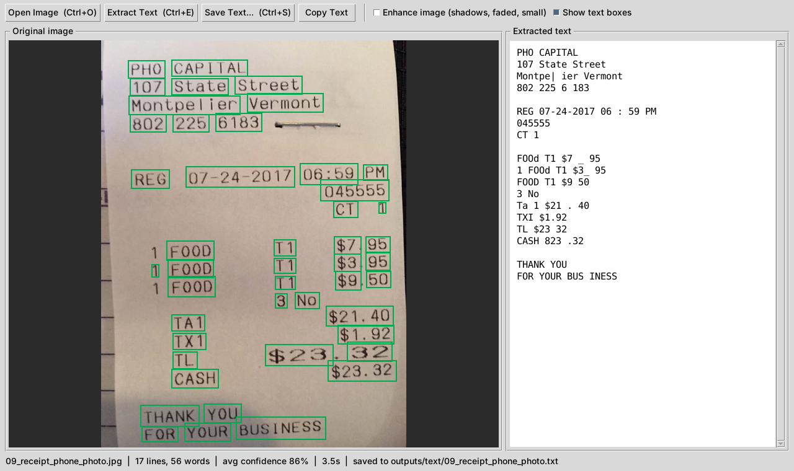

# Simple OCR Document Reader

A Python application that reads all visible text from an image with
**EasyOCR**, shows it next to the original image, and saves it as a `.txt` file.
It comes in three forms that share one OCR engine: a **web app** (Streamlit,
deployed online), a **desktop app** (Tkinter) and a **command-line mode** for whole
folders. Tested on a dataset of 20 real document and scene photos.

**🌐 Live demo:** _link added after deployment_



## Features

| Requirement | How it is done |
|---|---|
| Accepts an image as input | Web app: upload, camera photo or one of 20 samples. Desktop app: **Open Image** (Ctrl+O). Command line: `--image file.jpg` or `--batch folder` |
| Extracts all visible text with EasyOCR | `ocr_reader/engine.py`. The model loads once and is reused for every image |
| Displays the extracted text | Right-hand panel of the web/desktop app (editable, so you can fix mistakes), or printed in the terminal |
| Saves the text to a `.txt` file | Web: **Download .txt** button. Desktop: auto-saved to `outputs/text/<image name>.txt`, plus **Save Text...** |
| Shows the original image and the text | Web/desktop: image on the left, text on the right. Batch mode: a side-by-side preview image per input in `outputs/previews/` |

Extras:
- **Reading order rebuilt:** EasyOCR returns text boxes in a random order. The
  app groups them into lines, paragraphs and columns (XY-cut layout analysis),
  so a receipt reads row by row and a clean two-column page reads column by column.
- **Optional image enhancement** (from Task 1): fixes shadows, faded print
  and tiny images before OCR.
- **Text boxes** drawn on the image so you can see exactly what was detected.
- **Confidence, word count and time** for every image, plus `summary.csv` for the whole batch.
- **No freezing:** OCR runs in a background thread while the window stays responsive.
- Handles phone photos stored sideways (EXIF rotation) and JPG, PNG, BMP, TIFF and WEBP files.

## Project structure

```
Mini_Project/
├── streamlit_app.py        web app (deployed to Streamlit Community Cloud)
├── main.py                 entry point: desktop app or command line
├── run_app.bat             double-click to start the desktop app on Windows
├── requirements.txt        used locally and by Streamlit Cloud
├── .streamlit/config.toml  web app theme and upload limit
├── ocr_reader/
│   ├── config.py           paths and default settings
│   ├── engine.py           EasyOCR wrapper + reading-order / layout logic
│   ├── preprocessing.py    image loading (files or uploaded bytes) and optional enhancement
│   ├── output.py           .txt files, preview images, summary CSV
│   └── gui.py              Tkinter desktop app
├── dataset/                20 test images + SOURCES.md (where each came from)
├── outputs/
│   ├── text/               extracted text, one .txt per image
│   ├── previews/           original image + extracted text side by side
│   └── summary.csv         lines, words, confidence and time per image
└── screenshots/            screenshots of the app
```

## Setup (Windows, Python 3.11.9)

```bat
cd Mini_Project
py -3.11 -m pip install -r requirements.txt
```

The `py -3.11` launcher makes sure Python 3.11 is used even if a newer Python
is also installed. The first run downloads the EasyOCR English models
(about 100 MB) into `C:\Users\<you>\.EasyOCR\`, so internet is needed once.
If you already installed EasyOCR for Task 1, this step finishes immediately.

Optional, to keep this project's packages separate from other projects:

```bat
py -3.11 -m venv .venv
.venv\Scripts\activate
pip install -r requirements.txt
```

## How to use

**Web app (Streamlit)**

```bat
py -3.11 -m streamlit run streamlit_app.py
```

Your browser opens at http://localhost:8501. Upload an image, take a photo with the
webcam, or pick a sample. The text appears next to the image; edit it if needed and click
**Download .txt**. Tick **Enhance image** in the sidebar for shadowed, faded or tiny text.

**Desktop app**

```bat
py -3.11 main.py
```
or just double-click `run_app.bat`.

1. Wait for the status bar to say *Model ready* (a few seconds).
2. Click **Open Image**. The text is extracted automatically.
3. Check the text on the right (you can edit it), then use **Save Text...** or
   **Copy Text**. A copy is always saved to `outputs/text/`.
4. For a shadowed, faded or very small image, tick **Enhance image** and press
   **Extract Text** again.

You can also open the app with an image already loaded:
`py -3.11 main.py --open dataset\09_receipt_phone_photo.jpg`

**Command line, one image**

```bat
py -3.11 main.py --image dataset\09_receipt_phone_photo.jpg
py -3.11 main.py --image dataset\09_receipt_phone_photo.jpg --show       :: also opens the preview
py -3.11 main.py --image dataset\07_table_low_resolution.jpg --enhance
```

**Command line, whole folder**

```bat
py -3.11 main.py --batch dataset
```

| Option | Meaning |
|---|---|
| `--enhance` | Clean the image before OCR (shadows, faded print, tiny text) |
| `--lang en ur` | EasyOCR languages (default `en`). Example: English + Urdu |
| `--output folder` | Where to save results (default `outputs/`) |
| `--show` | With `--image`: open the preview image when done |

## Dataset

20 real images from public OCR sample sets (full list with sources in
[`dataset/SOURCES.md`](dataset/SOURCES.md)):

- **Printed / typed:** 12 pt text, multilingual page, typewritten page, very large italic text
- **Books & papers:** scanned manual page, two-column magazine page, research paper, low-resolution table
- **Receipts & invoices:** phone photo, clean scan, long faded receipt, low-contrast receipt, tax invoice
- **Signboards:** outdoor logo sign, small park sign, dim indoor sign
- **Handwriting:** handwritten page, single handwritten line, historic handwriting
- **Lighting:** clean scans, uneven wall lighting, shadow, grey low-contrast photos, low light indoors
- **Text size:** 238 px images with huge letters up to 4000 px pages with tiny newspaper print

## Results

Batch run on all 20 images (CPU, Python 3.11.9, enhancement off):

| Image | Lines | Words | Avg confidence | Time |
|---|---|---|---|---|
| 01 printed_text_12pt | 8 | 60 | 78.8% | 1.6 s |
| 02 printed_multilingual | 12 | 66 | 90.5% | 3.9 s |
| 03 typewritten_page_photo | 17 | 105 | 94.6% | 23.1 s |
| 04 scanned_book_page | 59 | 713 | 76.1% | 32.0 s |
| 05 newspaper_page_small_text | 57 | 742 | 84.1% | 32.9 s |
| 06 research_paper_page | 40 | 324 | 82.7% | 7.0 s |
| 07 table_low_resolution | 16 | 66 | 80.1% | 1.1 s |
| 08 wall_notice_uneven_light | 11 | 75 | 80.0% | 8.6 s |
| 09 receipt_phone_photo | 17 | 56 | 85.9% | 3.4 s |
| 10 receipt_scan_clean | 19 | 60 | 73.2% | 1.7 s |
| 11 receipt_scan_long | 26 | 86 | 54.1% | 2.7 s |
| 12 receipt_low_contrast | 48 | 174 | 77.3% | 9.6 s |
| 13 tax_invoice_scan | 39 | 141 | 65.1% | 7.6 s |
| 14 signboard_outdoor_large_text | 4 | 11 | 63.9% | 1.6 s |
| 15 park_sign_small_text | 3 | 4 | 85.1% | 3.6 s |
| 16 indoor_sign_low_light | 3 | 10 | 62.4% | 4.0 s |
| 17 large_italic_text | 3 | 3 | 99.3% | 0.2 s |
| 18 handwritten_page | 11 | 100 | 44.8% | 3.2 s |
| 19 handwritten_line | 1 | 5 | 74.9% | 0.2 s |
| 20 historic_handwriting | 32 | 331 | 26.3% | 16.9 s |

Total: 166 seconds for all 20 images on a CPU. A GPU is used automatically when available.

### What the results show

- **Printed text is read very well**, even when the confidence number looks
  modest. The 12 pt page (78.8% confidence) came out word-perfect; only two
  full stops were wrong (one missing, one read as `:`). The multilingual page
  read English, German, French, Italian and Spanish lines with small slips
  (`über` → `iber`, `zorro` → `ZOrIO`).
- **Lighting matters less than resolution.** The grey wall notice and the
  shadowed receipt photo were read almost perfectly, and even the dim indoor
  sign came through with small errors (`Publlc`, `Admisslon`). What hurt most was
  **tiny text**. On the 371 px table, plain OCR dropped many numbers, while
  `--enhance` (which upscales small images) recovered almost every row:

  | Without enhance | With enhance |
  |---|---|
  | `SegLink [26] 70.0 8.9` | `SegLink [26] 70.0 86.0 77.0 8.9` |
  | `PixelLink [4] 3` | `PixelLink [4] 73.2 83.0 77.8` |
  | `TexSild {} 87.4 813` | `TextField [37] 75.9 87.4 81.3 5.2` |

- **Receipts and invoices** are mostly right, but they show the typical OCR
  errors in thermal print: `0`↔`O`, `1`↔`I`, `5`↔`S`, and decimal points
  read as spaces (`$7.95` → `$7 _ 95`). Totals and dates usually come through
  correctly.
- **Signboards:** big, clear text works (park sign: `BEWARE OF MAINTENANCE VEHICLES`).
  On the round restaurant sign, the plain text (`BARBECUES FILIPINO` and the web
  address) was read, but the big stylised logo was not. EasyOCR is built for
  normal fonts, not decorative lettering.
- **Handwriting is the weak point.** The neat single line was read
  (`Ov Wovk On line leve(` for "or work on line level"), but full handwritten
  pages and the historic letter produce mostly wrong words (26–45% confidence).
  For handwriting, a dedicated handwriting model (e.g. TrOCR) is the right tool.
- **Confidence is a useful warning light:** every image at about 65% average
  confidence or lower (long receipt, tax invoice, logo sign, indoor sign,
  handwriting) really did need checking by hand.

## How it works

```
image ──► load (fix rotation, any format)
      ──► [optional] enhance: grayscale → upscale small → shadow removal → denoise → contrast
      ──► EasyOCR: CRAFT finds text regions, CRNN reads each one
      ──► layout: XY-cut splits the page into blocks/columns, boxes on one row become a line
      ──► show in app  +  save .txt  +  preview image  +  summary.csv
```

## Deploying to Streamlit Community Cloud

1. Push the repository to GitHub (this folder lives at `Day-29/Mini_Project`).
2. Go to [share.streamlit.io](https://share.streamlit.io), sign in with GitHub and click **Create app**.
3. Repository `MuhammadAwais005/MLB-Internship`, branch `main`,
   main file path `Day-29/Mini_Project/streamlit_app.py`.
4. Under **Advanced settings**, choose **Python 3.11**, then **Deploy**.

Streamlit Cloud installs `requirements.txt` from the same folder as the app. It uses the
CPU-only build of PyTorch, because the default GPU build is too large for the free
servers. The first build takes a few minutes, and the first OCR after a restart takes
about a minute while EasyOCR downloads its model.

## Known limitations

- **Complex magazine layouts** (a photo or caption spanning both columns, as in
  image 05) can still mix the two columns line by line. The words are correct,
  but the order isn't. Clean two-column pages are read column by column.
- Handwriting and decorative fonts are unreliable (see results).
- On a CPU, very large pages (2500–4000 px) take 20–35 seconds each.

## Troubleshooting

| Problem | Fix |
|---|---|
| `ModuleNotFoundError: easyocr` | Install with `py -3.11 -m pip install -r requirements.txt`, not plain `pip` (that may install into another Python) |
| First run is slow / downloading | EasyOCR downloads its models once (~100 MB). Later runs start in a few seconds |
| Window opens but buttons are disabled | The model is still loading. Wait for *Model ready* in the status bar |
| Very slow on large photos | Normal on a CPU. Resize huge photos, or use a PC with an NVIDIA GPU (detected automatically) |

## Tested environment

- Python 3.11.9
- easyocr 1.7.2, torch 2.15.0, torchvision 0.29.2, opencv-python-headless 5.0.0.93, numpy 2.4.6, pillow 13.0.0
- All of these have official Windows wheels for Python 3.11 (checked), so nothing has to be compiled.
