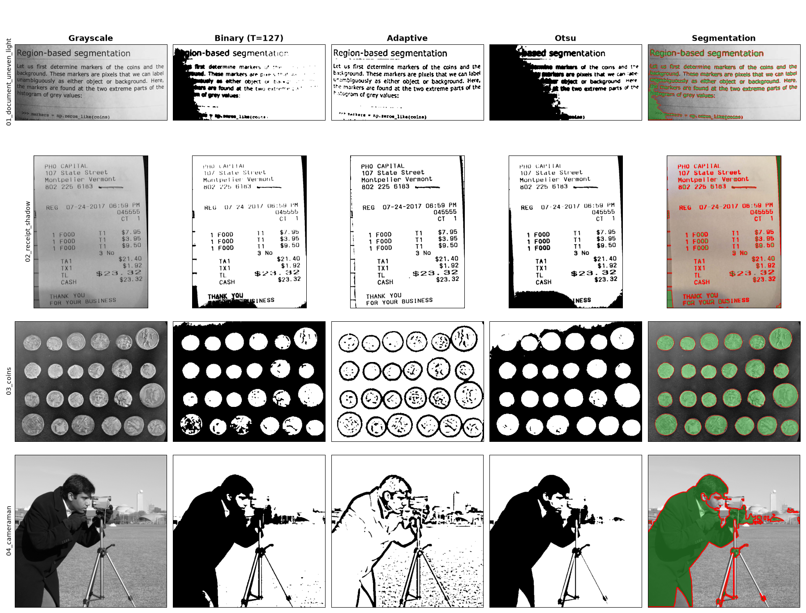
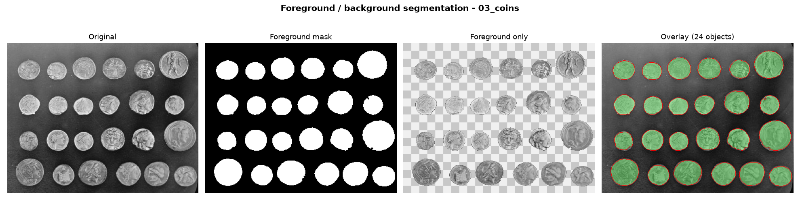

# Day 30 – Coding Practice: Image Thresholding & Segmentation

Binary vs Adaptive vs Otsu thresholding with OpenCV, compared on four images
with very different lighting, plus a simple foreground/background segmentation.



## Tasks covered

| Task | Where |
|---|---|
| Read an image and convert it to grayscale | `read_image()`, `to_grayscale()`. Output: `01_grayscale.png` |
| Binary thresholding | `binary_threshold()` (fixed T = 127). Output: `02_binary.png` |
| Adaptive thresholding | `adaptive_threshold()` (Gaussian, automatic block size, C = 10). Output: `03_adaptive.png` |
| Otsu thresholding | `otsu_threshold()` (threshold picked from the histogram). Output: `04_otsu.png` |
| Compare all three methods | `comparison.png` per image (with histogram), `all_methods_overview.png`, `summary.csv` |
| Foreground/background segmentation | `segment_foreground()`. Outputs: `05`–`08` and `segmentation.png` |
| Save outputs for comparison | everything goes to `outputs/<image name>/` |

## How to run (Python 3.11.9)

```bat
py -3.11 -m pip install -r requirements.txt
py -3.11 thresholding.py
```

Options:

```bat
py -3.11 thresholding.py --image path\to\photo.jpg     :: one image
py -3.11 thresholding.py --threshold 100                :: different binary threshold
py -3.11 thresholding.py --block-size 31 --c 12         :: tune adaptive thresholding
```

## Test images

| Image | Why it was chosen |
|---|---|
| `01_document_uneven_light.png` | Printed page lit from one side: dark on the left, bright on the right. The classic case where global thresholds fail |
| `02_receipt_shadow.jpg` | Real phone photo of a receipt with a shadow at the bottom and a dark edge (from the Day 29 OCR dataset) |
| `03_coins.png` | 24 coins on a dark background, slightly brighter at the top. Ideal for object segmentation |
| `04_cameraman.png` | Natural photo: dark person and camera against a bright sky and grass |

Images 01, 03 and 04 are standard test images that ship with scikit-image.

## How the three methods work

All three methods receive the **same** grayscale image with a light 5×5 Gaussian blur,
so the comparison is about the thresholding rule only.

| Method | Rule | Strength | Weakness |
|---|---|---|---|
| **Binary** | One fixed value for the whole image: pixel > T → white | Simplest and fastest. Predictable | You must guess T, and one value can't handle uneven light |
| **Adaptive** | Each pixel gets its own threshold: Gaussian mean of its neighbourhood − C | Handles shadows and uneven lighting | Only finds edges and fine detail. Large solid objects turn into outlines |
| **Otsu** | One value for the whole image, chosen automatically to best separate the two pixel groups | No guessing. Excellent when the histogram has two clear peaks | Still global, so it fails under uneven lighting just like Binary |

## Results

Threshold chosen and share of the image that became black (from `outputs/summary.csv`):

| Image | Binary (T=127) | Adaptive | Otsu | Best for this image |
|---|---|---|---|---|
| Document, uneven light | 22% black, left side lost | 13% black, **all text clean** | T=168, 46% black, left half lost | **Adaptive** |
| Receipt, shadow | 9% black, shadow at bottom becomes a black blob | 8% black, **clean text and edges** | T=144, 15% black, bigger shadow blob | **Adaptive** |
| Coins | 70% black, coins full of holes | outlines of coins only | T=104, **solid coins** (17 dark blobs vs 39 for Binary) | **Otsu** |
| Cameraman | 35% black, good silhouette | outlines and grass noise (331 blobs) | T=102, **cleanest silhouette** (17 blobs) | **Otsu** |

All methods run in under 5 ms per image, so speed doesn't decide anything here.

### What the comparison shows

- **Uneven lighting decides the winner.** On the document, the histogram has no
  clean valley between "ink" and "paper", because paper on the dark side is as grey as ink on
  the bright side. Every global threshold (127 or Otsu's 168) has to cut somewhere in
  that overlap, so one side of the page is always lost. Adaptive compares each pixel only with
  its neighbours, so it doesn't care about the lighting.
- **Otsu beats a guessed threshold whenever the histogram is two-peaked.** For the
  coins it picked T=104 instead of 127. The coins became solid discs, and the
  number of stray dark blobs dropped from 39 to 17. On the cameraman it reduced noise
  from 40 blobs to 17. The *separability* score in `summary.csv` (0–1, higher = cleaner
  split) predicts this: cameraman 0.86 and coins 0.77 suit global methods; the receipt at
  0.59 does not.
- **Adaptive is the wrong tool for big objects.** It turned the coins and the cameraman's
  coat into outlines, because inside a large uniform area every pixel looks like its
  neighbours. Adaptive is for text and fine detail; Otsu is for objects.
- **Rule of thumb:** documents, receipts and anything photographed under real lighting
  → Adaptive. Objects on a plain background or well-lit scans → Otsu. Fixed Binary
  → only when you control the lighting (scanner, industrial camera) and know the right value.

## Foreground / background segmentation

Pipeline in `segment_foreground()`:

1. **Illumination correction:** divide the image by a heavily blurred copy of itself, so
   slow brightness changes (lamp, shadow, vignette) disappear.
2. **Otsu threshold** on the corrected image.
3. **Choose which side is the foreground:** the background is whatever colour touches the
   image border the most. This works for bright coins on black and for a dark person on a
   bright sky, without any setting.
4. **Cleanup:** 3×3 opening removes specks, closing joins broken edges, enclosed holes are
   filled (e.g. reflections inside a coin), and specks below 0.005% of the image are dropped.
5. **Outputs:** mask, foreground on a transparent background (`06_foreground.png`), the
   background with the object removed, and an outlined overlay.

| Image | Result |
|---|---|
| Coins | **24 of 24 coins** segmented as separate solid objects, including the top row |
| Cameraman | Person, camera and tripod separated from the sky and grass in one main region (a few small extra regions from buildings and grass) |
| Receipt | All printed text extracted as foreground, including the shadowed "THANK YOU" lines |
| Document | Text extracted across the whole page. A little shading at the far-left edge is still included |

Without step 1, plain Otsu merged the brighter top strip of the coin image with the top row
of coins, and it lost the shadowed part of the receipt. Correcting the lighting first fixed both.



## Output files

```
outputs/
├── all_methods_overview.png       every image × every method
├── summary.csv                    threshold, black/white %, blobs, time, separability
└── <image name>/
    ├── 01_grayscale.png
    ├── 02_binary.png
    ├── 03_adaptive.png
    ├── 04_otsu.png
    ├── 05_segmentation_mask.png
    ├── 06_foreground.png          foreground with transparent background
    ├── 07_background.png          background with the foreground removed
    ├── 08_segmentation_overlay.png
    ├── comparison.png             3 methods side by side + histogram with thresholds
    └── segmentation.png           mask, cut-out and overlay
```
