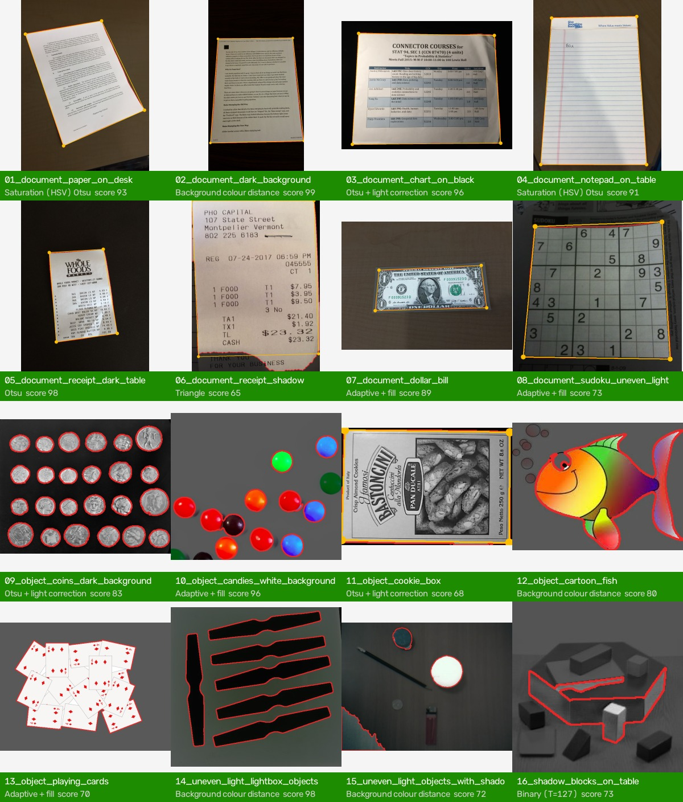

# Document & Object Segmentation Tool

A Python application that separates the **main object or document** from the background
with seven thresholding techniques, shows the result of every method side by side,
picks the best one automatically, and saves it. Documents are also straightened into a
flat, top-down scan.

It comes as a **Streamlit web app** and a **command-line tool**, and was tested on 16 real
images: documents, objects on plain backgrounds, uneven lighting and shadows.



## Requirements covered

| Requirement | How |
|---|---|
| Accept an input image | Web app: upload, camera or one of 16 samples. CLI: `--image file.jpg` or `--batch folder` |
| Apply different thresholding techniques | 7 methods (table below), all in `segmenter/methods.py` |
| Segment the foreground from the background | Each threshold goes through the same cleanup: foreground choice, morphology, hole filling, main-object selection (`segmenter/pipeline.py`) |
| Display the output of each method | Web app: a grid of all 7 results with scores (overlay / cut-out / mask view). CLI: `<name>_comparison.jpg` per image plus a score table in the terminal |
| Save the best segmentation result | Best method chosen by a quality score (`segmenter/scoring.py`) and saved as a transparent cut-out, mask and overlay, plus a straightened scan for documents. You can override the choice |

## The seven thresholding techniques

| # | Method | Idea | Good for |
|---|---|---|---|
| 1 | **Binary (T=127)** | One fixed threshold for the whole image | Baseline; controlled lighting |
| 2 | **Otsu** | Threshold picked automatically from the histogram (best class separation) | Clear two-tone images |
| 3 | **Triangle** | Threshold from the shape of the histogram peak | Background takes up most of the image |
| 4 | **Adaptive + fill** | Local threshold per pixel (finds edges), outline closed and filled | Low contrast, white-on-white, uneven light |
| 5 | **Otsu + light correction** | Image divided by its blurred self to remove the lighting, then Otsu | Uneven lighting, vignettes |
| 6 | **Saturation (HSV) Otsu** | Otsu on colour saturation | Colourful objects; ignores grey shadows |
| 7 | **Background colour distance** | Colour distance (Lab) from the border colour, brightness weighted ½, then Otsu | Plain backgrounds; tolerates shadows |

All methods run on the same copy of the image (resized to at most 1000 px, lightly
blurred) and share the same cleanup, so **only the thresholding technique differs**.

### Shared cleanup (turns a threshold into an object mask)

1. **Which side is the object?** The colour that covers most of the image border is
   background. This works for a light page on a dark desk and dark objects on a light table alike.
2. **Morphology:** opening removes specks, closing bridges small gaps.
3. **Fill holes:** text on a page or reflections on a coin become part of the object.
4. **Main object(s):** keep the largest region plus any region at least ¼ of its size
   (one document stays alone, all 24 coins are kept). Use **Keep every object** to keep all.
5. Scale the mask back up to the full image resolution.

### How the best result is chosen

There's no "right answer" for a user's photo, so each mask gets a **0–100 quality score**
from four checks (`segmenter/scoring.py`):

| Check | Weight | Question |
|---|---|---|
| Edge | 40% | Does the outline sit on real edges? (gradient on the boundary vs. the image average, log scale) |
| Contrast | 25% | Do inside and outside differ in colour? (Fisher separation in Lab) |
| Solidity | 20% | Is it a solid shape? (area / convex hull) |
| Border | 15% | Does it stay off the image border? |

Masks covering more than 95% or less than 0.5% of the image are heavily penalised, and
masks under 10% are scaled down gently (the main object is rarely tiny).

### Document mode

If the best mask is a page (at least 10% of the image, solidity ≥ 0.95, and four corners
that describe it closely), the page is **straightened with a perspective transform**. The
tool saves a colour scan plus a black-and-white version made with adaptive threshold.
All 8 documents in the dataset are detected; the card pile and the blocks are correctly rejected.

## Results on the dataset

`py -3.11 main.py --batch dataset` processes all 16 images in about 10 seconds on a CPU.

| Image | Best method | Score | Result |
|---|---|---|---|
| 01 Paper on desk | Saturation (HSV) Otsu | 93 | Page found and straightened |
| 02 Page on dark background | Background colour distance | 99 | Page found and straightened |
| 03 Chart on black | Otsu + light correction | 97 | Page found and straightened |
| 04 Notepad on table | Saturation (HSV) Otsu | 91 | Page found and straightened |
| 05 Receipt on dark table | Otsu | 98 | Receipt found and straightened |
| 06 Receipt with shadow | Triangle | 65 | Receipt found; the deeply shadowed bottom strip is cut off |
| 07 Dollar bill | Adaptive + fill | 89 | Bill found and straightened (global methods mix it with the light wood or catch only its dark print) |
| 08 Sudoku, uneven light | Adaptive + fill | 73 | Puzzle grid found and straightened |
| 09 Coins | Otsu + light correction | 83 | **All 24 coins** as separate objects |
| 10 Candies on white | Adaptive + fill | 96 | 10 candies; ones cut off by the image edge are left out |
| 11 Cookie box | Otsu + light correction | 68 | Box found (it fills 95% of the frame) |
| 12 Cartoon fish | Background colour distance | 80 | Whole fish including fins and tail; bubbles excluded |
| 13 Cards on white | Adaptive + fill | 70 | Whole card pile. **Only Adaptive works**: global methods find nothing |
| 14 Light box objects | Background colour distance | 98 | **All 6 parts** cleanly separated |
| 15 Objects with shadows | Background colour distance | 73 | Cap and ball found; the bright left corner is wrongly included |
| 16 Blocks with shadows | Binary (T=127) | 74 | Partial: only the large block's front face. Hardest image |

How often each method won: Background colour distance ×4, Adaptive + fill ×4,
Otsu + light correction ×3, Saturation ×2, Otsu ×1, Triangle ×1, Binary ×1.

### What the comparison shows

- **No single method wins everywhere.** That is the main reason the tool runs all seven and
  scores them. The winner changes with the type of image.
- **Plain grey-level thresholds (Binary, Otsu, Triangle) work when object and background
  differ in brightness**: receipts on dark tables, coins. They fail completely on the
  white cards (white on white), and on the dollar bill they either merge it with the light
  wood of the desk or catch only its dark printing.
- **Adaptive + fill is the specialist for low contrast.** It's the only method that finds
  the cards, and it wins on the dollar bill and candies, because it looks for local edges
  instead of absolute brightness.
- **Removing the lighting first helps a lot.** "Otsu + light correction" separates all
  24 coins, while plain Otsu merges the brighter top of the background with the top row of coins.
- **Colour beats grey under shadows.** Saturation and background-colour distance ignore
  shadows, because a shadow is the same colour as the surface, just darker. They win on the
  colourful and plain-background images.
- **Honest limits:** in image 15 the left corner of the table is brighter than the rest,
  so most methods take it for an object. Here *Adaptive + fill* (score 67, ranked 3rd) is
  visually cleanest, which is why the app lets you override the choice. Image 16 (grey blocks,
  strong shadows, a white wall and a grey table) can't be solved by any single threshold. It
  would need edge-based or learning-based segmentation.

## How to run (Python 3.11.9)

```bat
py -3.11 -m pip install -r requirements.txt
```

**Web app**

```bat
py -3.11 -m streamlit run streamlit_app.py
```

Choose a sample, upload an image or take a photo. The app shows the automatic choice, a
grid of all 7 results (switch between overlay, cut-out and mask), and a save section. You can
keep the best result or pick another method, then download the cut-out, mask or document scan,
or save them to `outputs/`.

**Command line**

```bat
py -3.11 main.py --batch dataset                         :: all images + summary.csv + overview
py -3.11 main.py --image dataset\09_object_coins_dark_background.png
py -3.11 main.py --image photo.jpg --method adaptive     :: save a specific method instead
py -3.11 main.py --image photo.jpg --save-all            :: also save every method's mask + cut-out
py -3.11 main.py --image photo.jpg --keep-all            :: keep every object, not just the main one
```

## Deploying to Streamlit Community Cloud

1. Push the repo to GitHub (this folder is `Day-30/Mini_Project`).
2. On [share.streamlit.io](https://share.streamlit.io): **Create app** → repo `MuhammadAwais005/MLB-Internship`,
   branch `main`, main file `Day-30/Mini_Project/streamlit_app.py`.
3. **Advanced settings** → Python 3.11 → **Deploy**.

Only OpenCV, NumPy, Pillow and Streamlit are installed (no deep learning), so the build
takes about a minute.

## Project structure

```
Mini_Project/
├── streamlit_app.py           web app
├── main.py                    command-line tool (single image or batch)
├── requirements.txt
├── .streamlit/config.toml     theme and upload limit
├── segmenter/
│   ├── config.py              paths and settings
│   ├── io_utils.py            loading (files, uploads, phone rotation) and safe saving
│   ├── methods.py             the 7 thresholding techniques
│   ├── pipeline.py            shared cleanup, runs all methods, picks the best
│   ├── scoring.py             0-100 quality score without ground truth
│   ├── document.py            page detection + perspective-corrected scan
│   └── output.py              cut-outs, overlays, comparison sheet, saving
├── dataset/                   16 test images + SOURCES.md
└── outputs/
    ├── best_results_overview.jpg   best result for every image
    ├── summary.csv                 every method's score breakdown for every image
    └── <image name>/
        ├── <name>_comparison.jpg        all 7 methods, best in green
        ├── <name>_best_cutout.png       transparent background
        ├── <name>_best_mask.png
        ├── <name>_best_overlay.jpg
        ├── <name>_document_scan.jpg     documents only
        └── <name>_document_scan_bw.png  documents only
```
